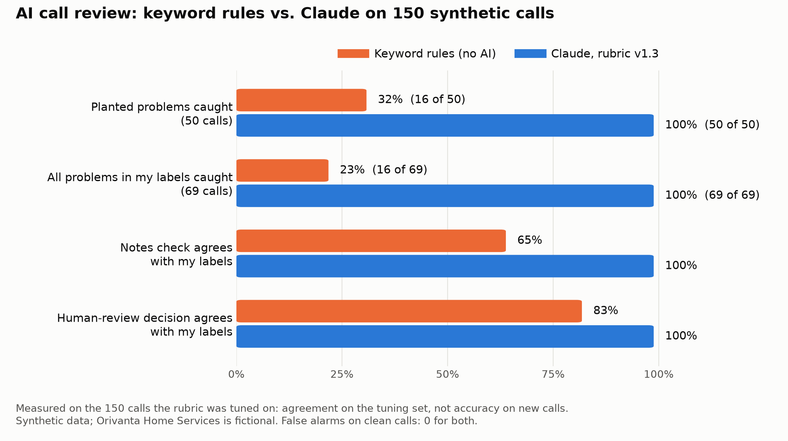
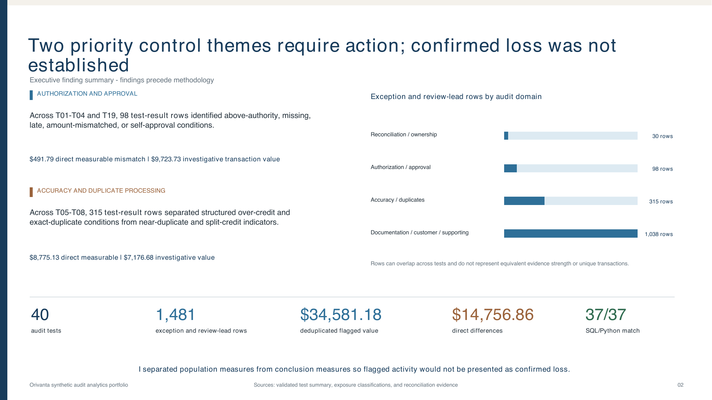

# Orivanta Audit Analytics

**AI evaluation | Human-in-the-loop review | Audit analytics | SQL/Python reconciliation**

This repository holds two projects built on the same fictional company:

1. **[AI transcript review](ai-transcript-review/):** a Claude reviewer for 150 synthetic customer-care calls, scored against 150 reference labels I manually reviewed and against a keyword-rules baseline. Claude caught 50 of 50 planted problems; the keyword rules caught 16. *Measured on the calls the rubric was tuned on, not on new calls.* [Case study](ai-transcript-review/CASE_STUDY.md) · [Sample output](ai-transcript-review/SAMPLE_OUTPUT.md)
2. **Audit analytics case study (this page):** 40 audit tests on synthetic credit, billing and reconciliation data, with SQL and Python results reconciled record by record.

[](ai-transcript-review/)

## Audit analytics case study

Orivanta is a fully synthetic audit analytics portfolio project examining credit authorization, billing accuracy, duplicate processing, documentation, customer-outcome indicators, and account reconciliation. The project shows how analytical testing can be translated into defensible audit judgment and practical management action.

> **Synthetic project disclosure:** Orivanta is a fictional company. All customers, employees, transactions, conversations, and events are synthetic. No employer, client, or proprietary data is used or implied.

## Start here

| Reader | Recommended artifact | What it provides |
|---|---|---|
| Recruiter or hiring manager | [Recruiter case study](case-study/Orivanta_Recruiter_Case_Study.pdf) | A 12-page executive case study focused on findings, judgment, controls, and my decisions |
| Audit, risk, controls, or operations leader | [Recruiter case study](case-study/Orivanta_Recruiter_Case_Study.pdf) | Business implications, evidence boundaries, control redesign, and a proposed 30/60/90-day action plan |
| Technical reviewer | [Technical evidence appendix](technical-appendix/Orivanta_Technical_Evidence_Appendix.pdf) | Test inventory, methodology, SQL/Python reconciliation, scenarios, traceability, and limitations |
| AI evaluation or product reviewer | [AI transcript review](ai-transcript-review/) | An AI reviewer for synthetic customer-care calls, scored against 150 reference labels I manually reviewed, with a [case study](ai-transcript-review/CASE_STUDY.md) on the rubric and its failure modes |
| Reproducibility reviewer | [`src/`](src/), [`sql/`](sql/), [`tests/`](tests/), and [`results/`](results/) | Selected implementation and validation evidence supporting the public claims |



## Executive conclusion

Two priority control themes require action:

1. **Authorization and approval:** recorded controls did not consistently evidence valid, timely, amount-accurate, and independent approval before posting.
2. **Accuracy and duplicate processing:** controls require stronger validation of eligible amounts, duplicate fingerprints, reversals, and aggregate related activity.

The analysis also identified documentation, customer-outcome, and reconciliation observations requiring contextual review and accountable disposition.

**Confirmed financial loss was not established.** Flagged values, measurable differences, investigative values, and confirmed loss are intentionally kept separate.

## Validated headline measures

| Measure | Validated result | Interpretation |
|---|---:|---|
| Audit tests | 40 | Business-risk-led analytical tests |
| Exception and review-lead rows | 1,481 | Rows may overlap across tests and are not unique transactions |
| Gross overlapping flagged value | $60,962.90 | Population measure before record-level overlap removal; not loss |
| Record-level deduplicated flagged value | $34,581.18 | One retained amount per documented record hierarchy; not confirmed loss |
| Direct measurable differences | $14,756.86 | Calculated differences under documented rules; still not confirmed loss |
| Investigative transaction value | $23,139.04 | Review population requiring contextual evidence |
| Confirmed financial loss | Not established | No final loss conclusion is supported |
| SQL/Python reconciliation | 37 of 37 | Supported tests reconciled at record-ID level |
| Automated tests | 74 passed | 5 core repository tests plus 69 boundary scenarios across nine priority tests |

These measures do **not** form an additive financial waterfall. See [Financial measure definitions](methodology/financial-measures.md).

## Decision chain

```text
Business risk
  -> control objective
  -> analytical test
  -> SQL/Python reconciliation
  -> evidence classification
  -> audit judgment
  -> financial interpretation
  -> management finding
  -> control redesign
  -> leadership action
```

SQL and Python do the testing; the focus is the audit decisions they support.

## Project-owner decisions

- Framed the analytics around business risks and control objectives rather than available tools.
- Reconciled supported SQL and Python outputs at record-ID level before relying on the results.
- Classified material observations as direct evidence, corroborating evidence, indicators, or unknown/unverified.
- Separated structured exceptions from behavioral and text-based review indicators.
- Separated investigative value from measurable differences so flagged activity would not be presented as confirmed loss.
- Translated the findings into preventive gates, detective monitoring, ownership, escalation, and a phased management action plan.

## Primary control responses developed

### Authorization and approval

- Pre-posting approval gate
- Approved-amount lock
- Self-approval prevention
- Daily authorization monitoring with named ownership and aging

### Accuracy and duplicate processing

- Remaining-eligible-amount gate
- Exact duplicate fingerprint
- Reversal-aware logic
- Aggregate authority evaluation
- Daily exception monitoring

The controls are **proposed designs**. Implementation and operating effectiveness are not claimed.

## Repository structure

```text
case-study/          Recruiter-facing PDF
technical-appendix/ Technical-review PDF
src/                 Python audit analytics implementation
sql/                 SQL test and reconciliation logic
tests/               Original tests and enhanced reference scenarios
notebooks/           Reproducible analytical notebook
data/                Synthetic source data and synthetic benchmark data
results/             Selected validated outputs supporting public claims
methodology/         Evidence and financial-interpretation definitions
validation/          Captured test-run evidence and validation guidance
ai-transcript-review/ AI reviewer for synthetic customer-care calls, scored against reference labels I manually reviewed (separate data set)
```

## Reproduce the analytical run

Python 3.11 or newer is recommended.

```bash
python -m venv .venv
source .venv/bin/activate
python -m pip install -r requirements.txt
python run_audit.py
python -m pytest tests -q
```

The run reads the synthetic CSV files in `data/synthetic_source/` and writes analytical outputs to `results/`. It also produces QA and benchmark-validation outputs in ignored working folders.

For SQL review, open `data/synthetic_source/orivanta_audit_analytics.sqlite` in a SQLite-compatible client and execute the documented scripts in [`sql/`](sql/).

## Evidence and claim boundaries

The repository supports conclusions about documented test conditions, calculation reproducibility, selected control attributes, and SQL/Python implementation consistency. It does not establish:

- employee or customer intent
- misconduct or fraud
- final root cause
- confirmed financial loss or recovery
- implemented remediation or operating effectiveness
- employer or client affiliation
- a functioning Power BI file; dashboard work remains design/specification only

Behavioral and transcript analytics are review indicators requiring human validation. See [Evidence framework](methodology/evidence-framework.md).

## Responsible AI disclosure

AI-assisted tools supported drafting, comparison, debugging, documentation, and quality review. AI outputs were not treated as audit evidence. Final calculations, evidence classifications, conclusions, and audit judgments were owner-reviewed.

## Validation status

- SQL/Python supported-test reconciliation: **37 of 37 passed at record-ID level**
- Automated tests: **74 passed** (5 core tests plus 69 boundary scenarios)

Detailed limitations and validation evidence are provided in the [technical appendix](technical-appendix/Orivanta_Technical_Evidence_Appendix.pdf).

## License

The code and repository documentation are available under the [MIT License](LICENSE). The synthetic data is included solely to support review and reproducibility of this portfolio project.

